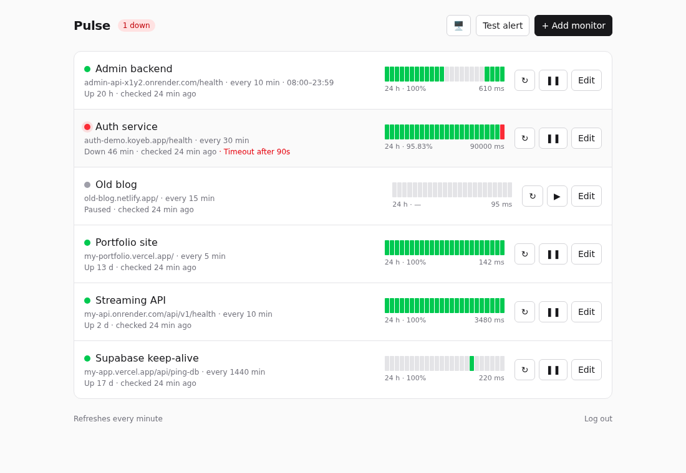
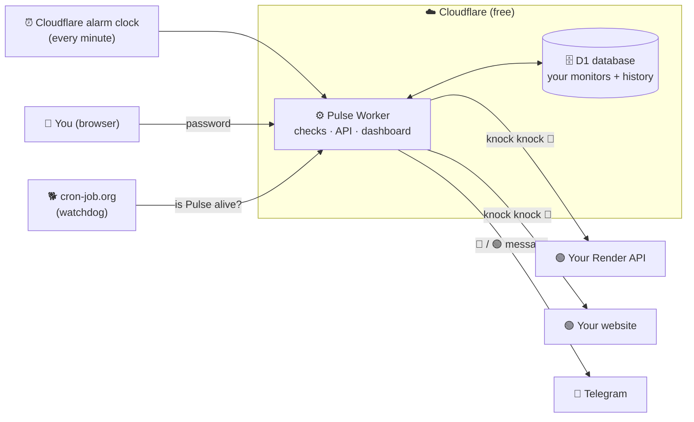
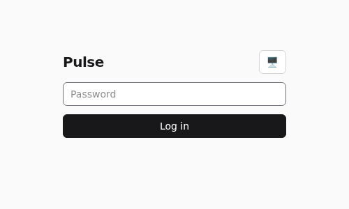
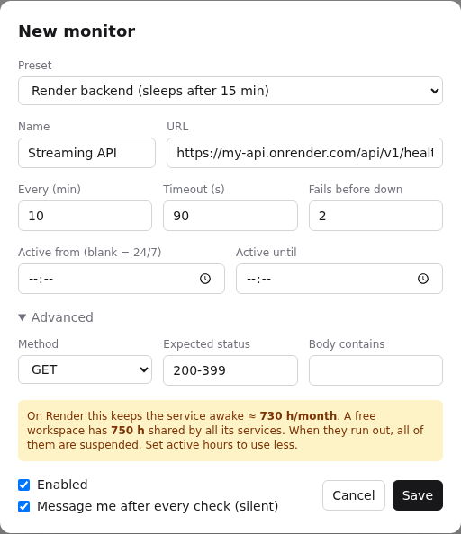
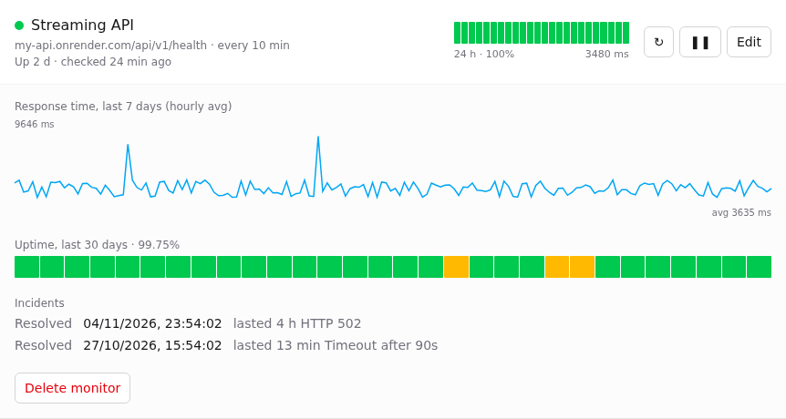
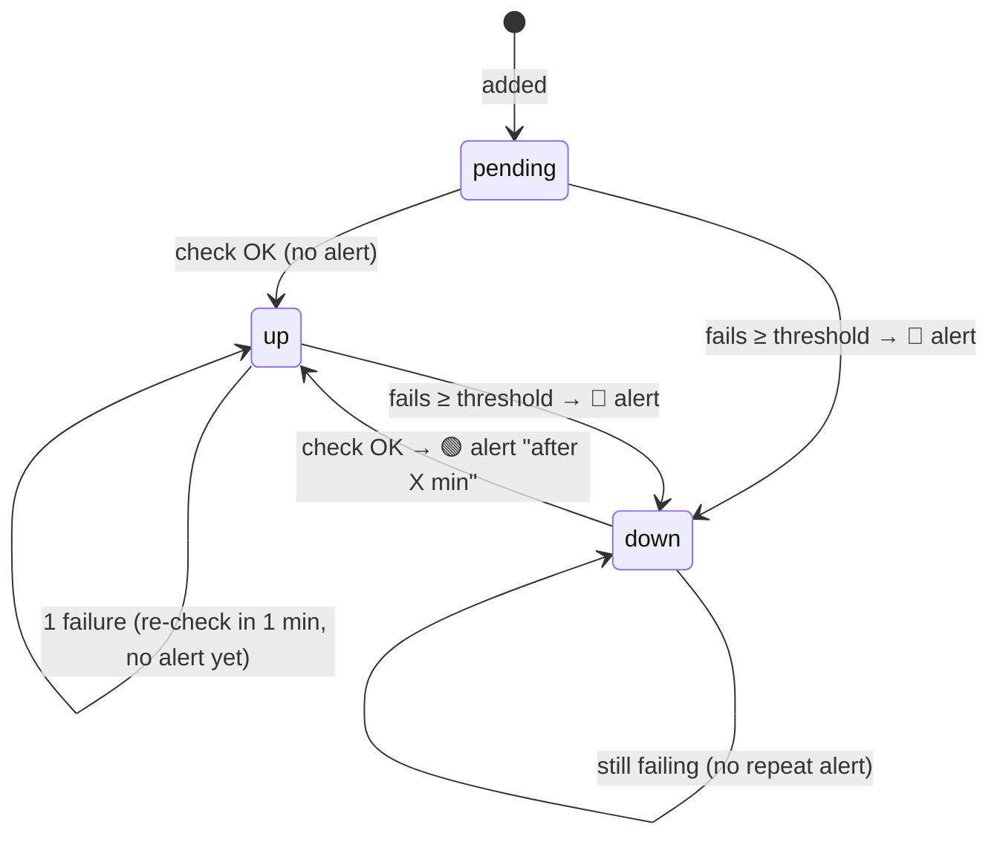

<div align="center">

# 💓 Pulse

**Keep your free-tier apps awake. Get a message on your phone when one goes down.**

Runs 100% on Cloudflare's free plan · **₹0 / $0 forever** · **no credit card** · nothing to keep running on your computer



</div>

---

## 📚 Table of contents

1. [What is Pulse? (the simple version)](#-1-what-is-pulse-the-simple-version)
2. [How it works (picture)](#-2-how-it-works-picture)
3. [Before you start: checklist](#-3-before-you-start-checklist)
4. [Setup, step by step](#-4-setup-step-by-step) (about 30 minutes, once)
   - [Step 1: Get the code](#step-1--get-the-code)
   - [Step 2: Connect your Cloudflare account](#step-2--connect-your-cloudflare-account)
   - [Step 3: Create the database](#step-3--create-the-database)
   - [Step 4: Create the tables](#step-4--create-the-tables)
   - [Step 5: Put Pulse on the internet](#step-5--put-pulse-on-the-internet)
   - [Step 6: Set your password](#step-6--set-your-password)
   - [Step 7: Phone alerts with Telegram](#step-7--phone-alerts-with-telegram)
   - [Step 8: Add your first app to watch](#step-8--add-your-first-app-to-watch)
   - [Step 9: Watch the watcher](#step-9--watch-the-watcher-recommended)
   - [Step 10: Save your settings to GitHub](#step-10--save-your-settings-to-github)
   - [Step 11 (optional): Extra lock with Cloudflare Access](#step-11-optional--extra-lock-with-cloudflare-access)
   - [Step 12 (optional): Auto-deploy when you push](#step-12-optional--auto-deploy-when-you-push-to-github)
5. [Using the dashboard](#-5-using-the-dashboard)
6. [What to watch, and how often](#-6-what-to-watch-and-how-often)
7. [Everyday tasks (change password, update, …)](#-7-everyday-tasks)
8. [Troubleshooting: "it's not working!"](#-8-troubleshooting-its-not-working)
9. [Free limits, and how Pulse stays inside them](#-9-free-limits-and-how-pulse-stays-inside-them)
10. [Running it on your own computer (developers)](#-10-running-it-on-your-own-computer-developers)
11. [How the code works](#-11-how-the-code-works)
12. [FAQ](#-12-faq)

---

## 🧸 1. What is Pulse? (the simple version)

Imagine your app is a shop. Free hosting (like **Render**) closes the shop and turns off the lights when nobody visits for 15 minutes. The next visitor has to wait **about a minute** in the dark while it opens again. 😴

**Pulse is a friend who knocks on the shop door every few minutes.** The lights never go off, so your real visitors never wait.

Pulse also notices when the shop **doesn't answer at all**, and sends you a message on Telegram right away:

```
🔴 Streaming API is DOWN — Timeout after 90s          ← loud alert
🟢 Streaming API is UP (412 ms) after 7 min           ← loud alert

📊 17 Nov, 14:20                                      ← silent, after every check (optional)
🟢 Streaming API · 181 ms
```

**What you get:**
- ⏰ Checks every 1–1440 minutes (you choose, per app)
- 🌙 "Active hours" (e.g. only 08:00–24:00) to save free hosting hours
- 📱 Telegram and/or ntfy alerts when something goes **down** and when it comes **back up** (with sound)
- 📊 Optional **silent** message after every check: "🟢 Streaming API · 181 ms"
- 🌗 Light, dark or follow-your-system theme
- 📈 Response-time chart, 24-hour and 30-day uptime, list of incidents
- 🔒 Private dashboard behind your own password
- 💸 Costs **nothing**. No card needed anywhere.

---

## 🧩 2. How it works (picture)



Every minute, Cloudflare wakes Pulse up. Pulse:
1. Looks in the database for apps whose turn it is.
2. Visits each one and times how long it takes to answer.
3. Writes down the result.
4. If an app just went **down** or came back **up**, it sends you a Telegram message.

Everything lives in **one Cloudflare Worker**. There's no server for you to run and no computer that has to stay on.

---

## ✅ 3. Before you start: checklist

| You need | How to check / get it | Cost |
|---|---|---|
| A computer with a terminal (Linux, macOS or Windows) | Linux/macOS: "Terminal" app · Windows: "PowerShell" | free |
| **Node.js 22 or newer** | run `node -v` → must print `v22…` or higher. If not, install the **LTS** version from https://nodejs.org | free |
| **git** | run `git --version`. If missing: https://git-scm.com/downloads | free |
| A **Cloudflare** account | sign up at https://dash.cloudflare.com/sign-up (**no card needed**) | free |
| **Telegram** on your phone | from the App Store / Play Store | free |
| A **GitHub** account (only if you want your own copy online) | https://github.com/signup | free |

⏱️ **Time needed:** about 30 minutes, one time only.

> 💡 **Windows users:** every command below works in PowerShell. When you see `cp a b`, use `copy a b`.

---

## 🚀 4. Setup, step by step

> 🧭 **Tip:** do the steps **in order** and don't skip any. Each step says what you should see when it worked ✅.

### Step 1 · Get the code

```bash
git clone https://github.com/durgaprasad2483/uptime-robot.git pulse
cd pulse
npm install
```

✅ **Worked if:** `npm install` finishes without red `ERR!` lines. Yellow `WARN` lines are fine.

> 💡 Want your **own** copy on GitHub? Click **Fork** on the GitHub page first, then clone *your* fork instead (replace `durgaprasad2483` with your GitHub username).

---

### Step 2 · Connect your Cloudflare account

```bash
npx wrangler login
```

1. A browser window opens. Log in to Cloudflare if asked.
2. Click **Allow**.
3. Go back to the terminal.

Check it worked:

```bash
npx wrangler whoami
```

✅ **Worked if:** it says `You are logged in` and shows your account. In the permissions list you should see `d1 (write)` and `workers (write)`.

---

### Step 3 · Create the database

```bash
npx wrangler d1 create pulse
```

Wrangler prints something like this, then **asks you questions**:

```text
✅ Successfully created DB 'pulse' in region APAC
...
      "database_id": "97d01a6a-ef63-4656-92c8-00e7d3c87bc1"     👈 COPY THIS
...
? Would you like Wrangler to add it on your behalf? …            👈 answer  No
```

> ⚠️ **Answer `No`** to *"add it on your behalf"*. If you answer *yes*, Wrangler adds a **second, wrong** database entry and the deploy will fail. (Already said yes? See [Troubleshooting](#-8-troubleshooting-its-not-working) → "binding DB … must have a valid database_id".)

Now open the file **`wrangler.jsonc`** in any text editor and find this block:

```jsonc
"d1_databases": [
    {
        "binding": "DB",
        "database_name": "pulse",
        "database_id": "97d01a6a-ef63-4656-92c8-00e7d3c87bc1",   👈 REPLACE with YOUR id
        "migrations_dir": "migrations"
    }
],
```

Replace the `database_id` value with **your** id from above, keeping the quotes. Save the file.

> 🧠 The id already in the file belongs to the original author's database. You can't use it, so you **must** replace it with yours.

✅ **Worked if:** there's exactly **one** `{ … }` block inside `"d1_databases"`, and it has `"binding": "DB"` and your id.

---

### Step 4 · Create the tables

```bash
npm run db:remote
```

If it asks *"Your database may not be available … continue?"*, type `y` and press Enter.

✅ **Worked if:** you see

```text
┌───────────────┬────────┐
│ name          │ status │
├───────────────┼────────┤
│ 0001_init.sql │ ✅     │
└───────────────┴────────┘
```

---

### Step 5 · Put Pulse on the internet

```bash
npm run deploy
```

**First time only**, Cloudflare asks you to pick a **workers.dev subdomain**. That's the middle part of your web address:

```text
? Would you like to register a workers.dev subdomain now? … yes
? What would you like your workers.dev subdomain to be? … pulse-alex
```

Rules for the name:
- only **lowercase letters, numbers and hyphens** (`-`). No spaces, no `\`, no `_`.
- it must be **unique in the whole world**. Short names like `pulse` are usually taken. If you see `Subdomain is unavailable`, just try another one (e.g. `pulse-yourname`).

✅ **Worked if:** the end of the output shows

```text
Deployed pulse triggers
  https://pulse.<your-subdomain>.workers.dev      👈 YOUR PULSE ADDRESS
  schedule: * * * * *
  schedule: 0 0 * * *
```

Open that address in your browser. You'll see this red message. **It is normal!** It means Pulse is safely locked until you set a password:

```text
┌─────────────────────────────────────────────────────────────────────────────┐
│ Pulse                                          [Test alert] [+ Add monitor]  │
│ ┌─────────────────────────────────────────────────────────────────────────┐ │
│ │ Set the ADMIN_PASSWORD secret (16+ characters): npx wrangler secret ... │ │
│ └─────────────────────────────────────────────────────────────────────────┘ │
└─────────────────────────────────────────────────────────────────────────────┘
```

> 💡 A new domain can take **a few minutes** to work worldwide. If the page doesn't load at all, wait 2–5 minutes and refresh.
>
> 💡 In Cloudflare's **Observability** tab you may see a few red "errors" from the first minutes. Those are just Pulse saying *"locked"* and *"the clock hasn't started yet"*. They're harmless.

---

### Step 6 · Set your password

**6.1 Make a strong password** (or invent your own, **at least 16 characters**):

```bash
node -e "console.log(require('crypto').randomBytes(18).toString('base64url'))"
```

It prints something like `Xq3v_9KzP1mR7tYb2LwN8eHd`. **Save it in your password manager** (or write it down somewhere safe).

> 💡 Easy-to-remember idea: a few random words, e.g. `mango-river-bike-2026` (21 characters ✅).

**6.2 Give it to Cloudflare** (stored encrypted, never in your code):

```bash
npx wrangler secret put ADMIN_PASSWORD
```

It asks `Enter a secret value:`. **Paste your password and press Enter.** Nothing appears while you paste; that's normal.

✅ **Worked if:** `✨ Success! Uploaded secret ADMIN_PASSWORD`

**6.3 Log in.** Refresh your Pulse address. You'll see:



Type your password → **Log in** → you'll see *"No monitors yet"*. 🎉 You stay logged in for **30 days**.

---

### Step 7 · Phone alerts with Telegram

You'll create your own little Telegram **bot**. Pulse uses it to message you.

**7.1 Create the bot**

1. In Telegram, search for **@BotFather** (the official one, with the blue ✔️) and open it.
2. Send `/newbot`.
3. It asks for a **name**. Type anything, e.g. `Pulse Alerts`.
4. It asks for a **username**. It must end in `bot`, e.g. `MyPulseAlerts_bot`.
5. BotFather replies with your **token**:

```text
┌──────────────────────────────────────────────────────────┐
│ BotFather                                                │
│ Done! Congratulations on your new bot. ...               │
│ Use this token to access the HTTP API:                   │
│ 1234567890:AAH-abcdefGhIJKlmnoPQRstuVWxyz_123456   👈    │
│ Keep your token secure ...                               │
└──────────────────────────────────────────────────────────┘
```

> 🔐 **The token is like a password for your bot.** Never put it in code, GitHub or screenshots. If it leaks: send `/revoke` to @BotFather to get a new one.

**7.2 Save the token in Cloudflare**

```bash
npx wrangler secret put TELEGRAM_BOT_TOKEN
```

Paste **only** the token. No quotes, no spaces.

**7.3 Say hi to your bot** ⚠️ *(people skip this step, and then it doesn't work!)*

Open your new bot in Telegram (tap the link BotFather gave you, e.g. `t.me/MyPulseAlerts_bot`), press **Start**, and send any message, like `hi`.

**7.4 Find your chat ID**

Open this address in your browser. Replace `<TOKEN>` with your token, and keep the word `bot` in front of it:

```text
https://api.telegram.org/bot<TOKEN>/getUpdates
```

You'll see text like this. Find **`"chat":{"id":`** and copy the number after it:

```json
{"ok":true,"result":[{"update_id":1,"message":{"message_id":1,
  "from":{...},
  "chat":{"id":123456789,"first_name":"Alex","type":"private"},   👈 123456789
  "date":1794890000,"text":"hi"}}]}
```

> ❓ See `{"ok":true,"result":[]}` (empty)? You haven't messaged the bot yet. Do 7.3, then refresh.

**7.5 Save the chat ID in Cloudflare**

```bash
npx wrangler secret put TELEGRAM_CHAT_ID
```

Paste **only the number** (e.g. `123456789`).

**7.6 Test it**

In Pulse, click **Test alert**.

✅ **Worked if:** a popup says **`Delivered to 1/1 channel(s)`** and Telegram shows ✅ *Pulse test alert — notifications work.*

❌ **Says `0/1`?** The popup also shows Telegram's reason:

| Popup says | Meaning | Fix |
|---|---|---|
| `"description":"Unauthorized"` (401) | token is wrong | redo **7.2** carefully |
| `"description":"Bad Request: chat not found"` (400) | chat ID is wrong, or you never pressed **Start** | redo **7.3 → 7.5** |
| `No alert channel configured` | one of the two secrets is missing | check with `npx wrangler secret list` |

<details>
<summary><b>📣 Prefer ntfy instead of (or as well as) Telegram?</b> (click to open)</summary>

[ntfy](https://ntfy.sh) sends push notifications without an account.

1. Install the **ntfy** app (Android / iOS).
2. Invent a long, hard-to-guess topic name, e.g. `pulse-alex-x7k29qv3`. Anyone who knows the name can read your alerts.
3. In the app: **+ Subscribe to topic** → type that name.
4. Save it in Cloudflare:
   ```bash
   npx wrangler secret put NTFY_TOPIC
   ```
5. Click **Test alert** in Pulse.
</details>

---

### Step 8 · Add your first app to watch

Click **+ Add monitor**:



| Field | What to put | Example |
|---|---|---|
| **Preset** | Pick the one that matches where your app lives. It fills in the numbers for you. | `Render backend (sleeps after 15 min)` |
| **Name** | Any nickname | `Streaming API` |
| **URL** | Your **backend's** address. A health route is best. | `https://my-api.onrender.com/api/v1/health` |
| **Every (min)** | How often to knock | `10` for Render |
| **Timeout (s)** | How long to wait for an answer. Sleeping Render apps take ~60 s to wake! | `90` |
| **Fails before down** | How many failures in a row before you get an alert. `2` avoids false alarms. | `2` |
| **Active from / until** | Only knock during these hours (your timezone). **Blank = 24/7.** | `08:00` → `23:59` |
| *Advanced → Method* | `GET` (normal) or `HEAD` (lighter, no body) | `GET` |
| *Advanced → Expected status* | Which HTTP codes count as "OK" | `200-399` |
| *Advanced → Body contains* | Optional: the page must contain this text | `"status":"ok"` |
| **Message me after every check (silent)** | Sends a quiet Telegram message after **every** check with the status and response time. Down/up alerts are always sent, with sound. | ✅ on |

Click **Save**. ✅ **Worked if:** within a few seconds a 🟢 green dot and a response time appear.

> 🎯 **Which URL should I use?** Your **frontend** on Vercel/Netlify/Cloudflare Pages *never sleeps*. It feels slow because the **backend** it talks to is asleep. So watch the **backend**.
>
> 🎯 **Bonus:** if your health route also checks the database (like `/api/v1/health` returning `"mongodb":{"status":"up"}`), each knock keeps the **database** awake too.

---

### Step 9 · Watch the watcher (recommended)

What if Pulse itself stops? A free service on another company's computers checks on Pulse.

Pulse has a public address that says whether its alarm clock is running:

```text
https://pulse.<your-subdomain>.workers.dev/api/health
→ {"ok":true,"last_tick":1794893232661}     (200 = alive ✅, 503 = clock stopped ❌)
```

1. Sign up (free) at **https://cron-job.org**.
2. **Create cronjob**:
   - **Title:** `Pulse health`
   - **URL:** `https://pulse.<your-subdomain>.workers.dev/api/health`
   - **Execution schedule:** every **5 minutes**
   - **Notifications:** turn on **"notify me when execution fails"**
3. **Create**.

✅ Now if Pulse ever stops, cron-job.org **emails** you.

---

### Step 10 · Save your settings to GitHub

You changed `wrangler.jsonc` (your database id). Save it:

```bash
git add wrangler.jsonc
git commit -m "Use my D1 database"
git push
```

> 🔐 **Safe to commit:** `database_id`, subdomain, timezone. **Never commit:** your password, bot token or chat ID. They live only in Cloudflare as secrets. The local file `.dev.vars` is already ignored by git.

🎉 **You're done!** Pulse is live, private, alerting you, and costs nothing. The steps below are optional.

---

### Step 11 (optional) · Extra lock with Cloudflare Access

Pulse already has its own password. Cloudflare Access adds a **second door in front** of it: Cloudflare emails you a one-time code before anyone can even see Pulse's login page.

> ⚠️ Setting up Cloudflare Zero Trust **may ask for a credit card**, even on the $0 plan (you won't be charged). If you don't want to add a card, **skip this step**. Pulse's password already protects you.

<details>
<summary><b>Show the steps</b></summary>

1. Cloudflare dashboard → **Workers & Pages** → **pulse** → **Access** tab → **Set up Zero Trust**.
   - Choose a **team name** (e.g. `pulse-alex`).
   - Choose the **Free** plan (up to 50 users).
2. **Workers & Pages** → **pulse** → **Domains** tab → on the **Production** row click **Enable Access →**.
3. Click **Manage Access** → edit the policy → **Include → Emails →** *your email only* → Save.
4. Keep the watchdog from Step 9 working. Zero Trust → **Access → Applications → Add an application → Self-hosted**:
   - Domain: `pulse.<your-subdomain>.workers.dev`, path: `api/health`
   - Policy: action **Bypass**, include **Everyone** → Save.
5. Test in a private/incognito window: you should get Cloudflare's email-code page first, then Pulse's password page.

Nothing changes in the code. Access works in front of the Worker.
</details>

---

### Step 12 (optional) · Auto-deploy when you push to GitHub

Cloudflare dashboard → **Workers & Pages** → **pulse** → **Settings** → **Builds** → **Git repository: GitHub** → pick your repo, then:

| Setting | Value |
|---|---|
| Production branch | `main` |
| Build command | `npm run build` |
| Deploy command | `npx wrangler deploy` |

From now on, every `git push` to `main` goes live by itself in ~1 minute.

> ⚠️ If you ever add a new file in `migrations/`, run `npm run db:remote` yourself once. Auto-deploy doesn't change the database.

---

## 📺 5. Using the dashboard


| You see | It means |
|---|---|
| 🟢 green dot | app is **up** |
| 🔴 red dot (pulsing) | app is **down**. The red text says why (e.g. `Timeout after 90s`, `HTTP 502`). |
| 🟡 yellow dot | **new** monitor, waiting for its first check |
| ⚪ grey dot | **paused** |
| `1 down` / `All systems up` | summary at the top |
| 24 little bars | the last 24 hours, one bar per hour |
| 🟩 bar | every check in that hour was OK |
| 🟨 bar | some checks failed (≥ 50% OK) |
| 🟥 bar | most checks failed |
| ⬜ bar | no checks that hour (paused, or outside active hours) |
| `24 h · 99.5%` | uptime in the last 24 hours |
| `3480 ms` | how long the last answer took |
| **↻** | check right now |
| **❚❚ / ▶** | pause / resume |
| **Edit** | change settings |
| 🖥️ / ☀️ / 🌙 | theme: follow your system → light → dark (remembered in this browser) |

**Click a row** to open its details:



- **Response time, last 7 days:** hourly average. Spikes usually mean a cold start.
- **Uptime, last 30 days:** one bar per day.
- **Incidents:** when it went down, for how long, and why.
- **Delete monitor:** removes it and all its history.

The page refreshes itself every minute while it's open.

---

## 🎯 6. What to watch, and how often

| Where your app lives | Falls asleep after | Preset to choose | Notes |
|---|---|---|---|
| **Render** (free web service) | 15 min without visitors | *Render backend*: every 10 min, timeout 90 s | ⚠️ read "Render's hour budget" below |
| **Koyeb** (free instance) | 1 hour without visitors | *Koyeb backend*: every 30 min | |
| **Supabase** (free) | 7 days without database activity | *Supabase / Atlas*: once a day | the URL must **use the database** |
| **MongoDB Atlas M0** | 30 days without connections | *Supabase / Atlas*: once a day | the URL must **use the database** |
| **Vercel / Netlify / Cloudflare Pages** | never sleeps | *Website*: every 5 min | only to get down alerts |
| **Neon** (free Postgres) | 5 min | ❌ don't keep it awake | it wakes in < 1 s, and keeping it awake burns your free compute hours |

### ⚠️ Render's hour budget (read this if you use Render)

Render gives every free **workspace** **750 hours per month** in total, shared by **all** its free services.

```text
1 service awake 24/7   →  24 h × 30.4 days ≈ 730 h   ✅ fits in 750
2 services awake 24/7  →  2 × 730 h       ≈ 1460 h   ❌ runs out around day 15
                          → Render SUSPENDS ALL your free services until next month!
```

**Fix:** use **Active hours**. Pulse shows the estimate in a yellow box while you fill the form.

```text
08:00 → 23:59  =  16 h/day × 30.4  ≈ 486 h per service
2 services     ≈ 972 h  ❌ still too much
1 service 24/7 + 1 service 08:00–12:00  ≈ 730 + 122 = 852 h  ❌
1 service 08:00–23:59 + 1 service 08:00–16:00 ≈ 486 + 243 = 729 h  ✅
```

Or put each always-awake service in a **separate Render workspace**.

> 📝 Render designed its free tier to sleep. Keeping services awake is allowed by its current docs, but it isn't what the free tier is meant for, and Render could change its rules. Use active hours to be fair, and use this at your own risk.

---

## 🧰 7. Everyday tasks

### 🔑 Change your password
```bash
npx wrangler secret put ADMIN_PASSWORD
```
Type the new one (16+ characters). It works within seconds, no redeploy needed. **Everyone gets logged out**, including any old sessions. Forgot your password? Just set a new one this way.

*(Or in the dashboard: **Workers & Pages → pulse → Settings → Variables and secrets → ADMIN_PASSWORD → ✏️ → Deploy**.)*

### 📱 Change the Telegram bot or chat
```bash
npx wrangler secret put TELEGRAM_BOT_TOKEN
npx wrangler secret put TELEGRAM_CHAT_ID
```
Then click **Test alert**.

### 🤫 Stop the "after every check" messages for one app
Click **Edit** on that app → untick **Message me after every check (silent)** → **Save**. You'll still get the loud 🔴 DOWN / 🟢 UP alerts.

### 🔕 Turn off Telegram alerts completely
```bash
npx wrangler secret delete TELEGRAM_BOT_TOKEN
```

### 🌍 Change the timezone (for "Active hours")
In `wrangler.jsonc`, change `"TIMEZONE": "Asia/Kolkata"` to your [IANA timezone](https://en.wikipedia.org/wiki/List_of_tz_database_time_zones) (e.g. `Europe/London`, `America/New_York`), then:
```bash
npm run deploy
```

### 🗓️ Keep history longer or shorter
`"RETENTION_DAYS": "90"` in `wrangler.jsonc` (how many days of charts and incidents to keep), then `npm run deploy`.

### 👀 See what Pulse is doing right now
```bash
npx wrangler tail
```
Live logs. Press `Ctrl + C` to stop. Or open the **Observability** tab in the Cloudflare dashboard.

### ⬆️ Get the newest version of Pulse
```bash
git pull
npm install
npm run db:remote     # applies new database changes, if any
npm run deploy
```

### 🔍 See which secrets are set (the values stay hidden)
```bash
npx wrangler secret list
```

### 🧹 Remove Pulse completely
```bash
npx wrangler delete           # deletes the Worker
npx wrangler d1 delete pulse  # deletes the database and ALL history
```

---

## 🆘 8. Troubleshooting: "it's not working!"

| What you see | Why | How to fix |
|---|---|---|
| `Invalid property: databaseId => Invalid uuid` | `wrangler.jsonc` still has a placeholder or someone else's id | Do **Step 3** again: paste **your** `database_id` |
| `binding DB of type d1 must have a valid database_id` | You answered **yes** to "add it on your behalf", so there are **two** database blocks | Open `wrangler.jsonc`, delete the extra block (the one with `"binding": "pulse"`), make sure the `"DB"` block has your id, then `npm run deploy` |
| `no such table: monitors` | Tables not created | `npm run db:remote` |
| `Subdomain is unavailable` | Someone already has that name | Pick another (lowercase, numbers, `-` only) |
| `… is invalid, please choose another subdomain` | You typed a character that isn't allowed (`\`, `_`, space, capitals) | Use only `a-z`, `0-9`, `-` |
| You are not authenticated / `wrangler login` | Not logged in on this computer | `npx wrangler login` |
| Red box: *Set the ADMIN_PASSWORD secret* | No password yet, or it's shorter than 16 characters | **Step 6** |
| *Wrong password* | Typo, or the password was changed | Type it again, or set a new one (Step 6.2) |
| Test alert: `Delivered to 0/1` + `Unauthorized` | Wrong bot token | **Step 7.2** |
| Test alert: `Delivered to 0/1` + `chat not found` | Wrong chat ID, or you never pressed Start in the bot | **Step 7.3 → 7.5** |
| Test alert: *No alert channel configured* | Telegram/ntfy secrets missing | **Step 7** |
| `getUpdates` shows `"result":[]` | You haven't messaged the bot | Open your bot → **Start** → send `hi` → refresh |
| A monitor stays 🟡 *Waiting for first check* | The alarm clock hasn't run yet | Wait 1–2 min. Check **Settings → Trigger events** shows *Every minute*. Check `/api/health`. |
| My Render app shows **down** but works in the browser | It took longer than the timeout to wake up | Set **Timeout** to `90` and **Fails before down** to `2` |
| Monitor shows `HTTP 403` / `HTTP 429` | The app (or its firewall) blocks robots | Allow the user-agent `PulseKeepAlive/1.0`, or monitor a different route |
| Monitor shows *Keyword … not found* | The page doesn't contain your "Body contains" text | Fix or clear that field (Edit → Advanced) |
| `/api/health` returns **503** | Pulse's clock hasn't run in 5+ minutes | Check **Settings → Trigger events**; run `npx wrangler tail`; redeploy with `npm run deploy` |
| Page doesn't open right after the first deploy | New subdomains take a few minutes | Wait 2–5 min, refresh |
| Red "errors" in Observability right after deploy | Normal: "locked" (no password yet) and "clock not started" | Ignore. They stop once the password is set and the clock runs |
| Render suspended all my services mid-month | 750-hour budget used up | Use **Active hours** (see section 6) |
| `npm install` fails / `Unsupported engine` | Node.js too old | Install Node **22 LTS** or newer, then `npm install` again |

Still stuck? Run `npx wrangler tail`, reproduce the problem, and read the red lines. They usually say exactly what's wrong.

---

## 📊 9. Free limits, and how Pulse stays inside them

| Cloudflare free limit | Pulse uses (10 apps, every 10 min) |
|---|---|
| Worker requests: 100,000 / day | ~1,500 (1 per minute + your dashboard visits) |
| D1 rows **written**: 100,000 / day ⭐ (the tightest limit) | ~5,800 (2 per check + 2 per minute for the clock) |
| D1 rows **read**: 5,000,000 / day | a few thousand |
| D1 storage: 5 GB | a few MB (only hourly summaries are stored) |
| CPU per run: 10 ms | ~2–3 ms (waiting for your apps doesn't count) |
| Outgoing requests per run: 50 | ≤ 35 checks + database + alerts |

**Rule of thumb:** keep *(number of apps) × (checks per day each)* under **≈ 40,000**.
- 20 apps every 5 min = 5,760/day ✅
- 30 apps every 1 min = 43,200/day ❌ too many

How it stays lean:
- **No raw check log.** Each check updates the app's row and adds 1 to an **hourly summary**. That's 2 writes per check.
- **No extra database indexes on busy tables.** Each index would cost an extra write on every check.
- **One database trip per minute** for all results, and **one combined Telegram message** if several apps change at once.
- **6 checks at a time, at most 35 per minute.** Anything extra waits for the next minute.
- **A lock** stops two clock runs from overlapping when a slow app takes over a minute to answer.
- **Every night (00:00 UTC)** history older than `RETENTION_DAYS` is deleted.
- **The dashboard** refreshes once a minute, only while the tab is visible.

---

## 💻 10. Running it on your own computer (developers)

```bash
cp .dev.vars.example .dev.vars    # local secrets; the password is local-dev-password-123
npm run db:local                  # create tables in a local database
npm run dev                       # http://localhost:5173
```

Fire the "every minute" clock by hand (in another terminal):
```bash
curl "http://localhost:5173/cdn-cgi/handler/scheduled?cron=*+*+*+*+*"
```

Other commands:

| Command | What it does |
|---|---|
| `npm test` | Unit tests (status matching, active hours, up/down logic, input validation) |
| `npm run build` | Type-check + build |
| `npm run typegen` | Regenerate `src/worker/env.d.ts` after changing `wrangler.jsonc` or `.dev.vars` |
| `npm run db:local` / `db:remote` | Apply migrations locally / to Cloudflare |
| `npm run deploy` | Build + deploy |

`.dev.vars` is only for your computer. It's never uploaded and it's ignored by git. The local database lives in `.wrangler/`.

---

## 🧠 11. How the code works

```text
migrations/0001_init.sql   📜 database tables
src/shared/types.ts        🔤 types shared by server + dashboard
src/worker/logic.ts        🧮 pure logic: status matching, active hours, up/down decisions, form checks (+ tests)
src/worker/engine.ts       ⚙️ knock on apps, save results, the every-minute tick, nightly cleanup, alerts
src/worker/auth.ts         🔑 password login → signed cookie
src/worker/index.ts        🚪 API routes + the cron entry point
src/client/                🖥️ the dashboard (React + Tailwind, no other UI libraries)
wrangler.jsonc             🛠️ Cloudflare settings (database, cron, variables)
```

**How a monitor decides it's up or down:**



**Database tables:**

| Table | What's in it |
|---|---|
| `monitors` | one row per app: settings (incl. `notify_every`) + current state (status, last response, next check time) |
| `stats` | one row per app per hour: number of checks, how many were OK, total/max response time |
| `incidents` | each down period: start, end, reason |
| `tick` | one row: the overlap lock + "last time the clock ran" (for `/api/health`) |

**API** (everything except `/health` and `/login` needs the login cookie):

| Method & path | Does |
|---|---|
| `GET /api/health` | public watchdog: 200 if the clock ran in the last 5 min, else 503 |
| `POST /api/login` · `POST /api/logout` | `{ "password": "…" }` → sets / clears the 30-day cookie |
| `GET /api/monitors` | all monitors + last 24 h of hourly stats |
| `POST /api/monitors` · `PUT /api/monitors/:id` · `DELETE /api/monitors/:id` | add / edit / delete |
| `POST /api/monitors/:id/check` | check right now |
| `GET /api/monitors/:id/history` | 30 days of hourly stats + last 20 incidents |
| `POST /api/alerts/test` | send a test alert, returns delivery result and errors |

**Settings** (`wrangler.jsonc` → `vars`) and **secrets** (`npx wrangler secret put …`):

| Name | Kind | Required | Meaning |
|---|---|---|---|
| `ADMIN_PASSWORD` | secret | ✅ | dashboard password, 16+ characters |
| `TELEGRAM_BOT_TOKEN` | secret | for Telegram | from @BotFather |
| `TELEGRAM_CHAT_ID` | secret | for Telegram | your chat number from `getUpdates` |
| `NTFY_TOPIC` | secret | for ntfy | your secret topic name |
| `TIMEZONE` | var | ✅ | for active hours, default `Asia/Kolkata` |
| `RETENTION_DAYS` | var | ✅ | how long to keep history, default `90` |

**Security in one breath:**
- The password is a Cloudflare secret, compared in constant time.
- Login gives an HMAC-signed, `HttpOnly`, `Secure`, `SameSite=Strict` cookie, and the password itself is the signing key, so changing it logs everyone out.
- Passwords shorter than 16 characters are refused, which makes guessing impractical.
- Everything except `/api/health` requires login.
- Preview URLs are disabled.

---

## ❓ 12. FAQ

**Is it really free? Will I ever be charged?**
Yes, it's free. You never enter a card, so Cloudflare *can't* charge you. If you somehow hit a free limit, things pause until midnight UTC instead of costing money.

**Can I check every 30 seconds?**
No. The smallest interval is 1 minute (Cloudflare's free cron). For keeping apps awake, 10 minutes is plenty.

**Does pinging use my Render hours?**
Pinging keeps the service *running*, and running time is what uses hours. Read "Render's hour budget" in [section 6](#-6-what-to-watch-and-how-often).

**Can other people see my dashboard?**
No. They'd need your password. Only `/api/health` is public, and it shows nothing except "the clock is running".

**My frontend is slow, should I monitor it?**
Monitor the **backend** it calls. Frontends on Vercel/Netlify/Cloudflare Pages don't sleep.

**How many apps can I add?**
Dozens. Stay under the rule of thumb in [section 9](#-9-free-limits-and-how-pulse-stays-inside-them).

**I lost my password.**
`npx wrangler secret put ADMIN_PASSWORD` and type a new one.

**Can I use my own domain (e.g. `status.mysite.com`)?**
Yes, if the domain is on Cloudflare: **Workers & Pages → pulse → Domains → Add Domain**.

---

<div align="center">
Made with 💓 to keep free apps awake.
</div>
